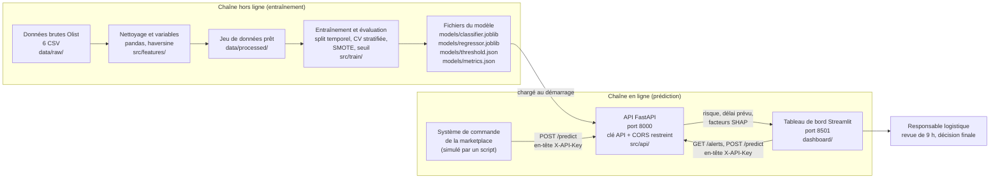

# Étude de conception – Prédiction du retard de livraison (Olist)

**Groupe :** SOUILI Wiam – ELAOUAZI Hafsa – YEKHLEF Aya – BELHACHMI Hajar
**Version :** Brouillon
**Date :** 11/10/2026

---

## 1. Contexte et utilisateurs

**Organisation ou situation :** une marketplace e-commerce brésilienne de type Olist, qui met en relation de petits vendeurs et des clients, la livraison étant assurée par des transporteurs. À l'achat, le client reçoit une date de livraison estimée. Sur les commandes livrées du jeu de données, 6,8 % arrivent après cette date (6 534 sur 96 470), ce qui dégrade l'expérience client et génère des réclamations.

**Utilisateur principal (un rôle précis) :** le responsable logistique / opérations de la marketplace, chargé de suivre les livraisons et de traiter les commandes problématiques.

---

## 2. Problème et décision

### 2.1 Le problème

**Situation :** à l'achat, le client reçoit une date de livraison estimée. Sur les commandes livrées du jeu de données, 6,8 % arrivent après cette date (6 534 sur 96 470), soit environ une commande sur quinze. Cette date est pourtant déjà prudente : sa MAE est d'environ 13 jours par rapport au délai réel.

**Problème à résoudre :** repérer, au moment de la commande, celles qui risquent d'arriver après la date estimée, et prévoir le délai de livraison en jours, en n'utilisant que les informations connues à l'achat.

**Ce qui rend le problème difficile :**

- les retards sont rares, donc une prédiction « toujours à l'heure » a 93 % d'accuracy sans rien détecter ;
- le taux de retard varie fortement selon la période (12 % en novembre 2017, 19 % en mars 2018, 1 % en juin 2018) ;
- le jeu de données ne contient ni données du transporteur, ni météo, ni jours fériés.

### 2.2 La décision

**Décision que l'utilisateur prend avec le système :** pour chaque nouvelle commande, décider s'il la signale « à risque de retard » et déclenche une action. Le système fournit aussi un délai de livraison prévu en jours, pour proposer une date plus réaliste.

**Utilisateur :** le responsable logistique / opérations de la marketplace.

**Actions possibles pour une commande signalée :**

| Action | Qui est concerné | Effet recherché |
|---|---|---|
| Repousser la date promise affichée au client | Le client | Une promesse réaliste, qui sera tenue |
| Relancer le vendeur ou le transporteur | Le vendeur, le transporteur | Réduire le retard avant qu'il ne se produise |
| Prévenir le client de façon proactive | Le client | Éviter la surprise et la réclamation |

### 2.3 Horaire de la décision

La décision se prend à deux moments, complétés par un suivi mensuel. Les horaires de la revue quotidienne et du suivi sont des propositions à valider avec l'équipe logistique.

| Moment | Ce qui se passe | Pourquoi ce choix |
|---|---|---|
| À la création de la commande, en quelques secondes | Le système calcule le risque de retard et le délai prévu, avant l'affichage de la date promise | Toutes les variables utilisées sont connues à l'achat. La date promise s'affiche à ce moment : la corriger après coup obligerait à revenir sur une promesse déjà faite. Plus l'alerte est précoce, plus il reste de temps pour relancer le vendeur ou le transporteur. |
| Chaque matin, en début de journée (par exemple 9 h) | Le responsable logistique traite la liste des commandes signalées depuis la veille, classées par niveau de risque | Les relances et les appels se font en heures ouvrées. Une revue unique, regroupée et priorisée, est plus efficace qu'un traitement au fil de l'eau. Un suivi à l'heure n'est pas justifié par le volume. |
| Chaque mois (proposition) | L'équipe compare le taux de retard prévu et le taux observé, et décide s'il faut réentraîner le modèle | Le taux de retard varie fortement d'une période à l'autre (de 1 % à 19 %) : un modèle entraîné sur le passé peut se dégrader. |

**Deux organisations ont été écartées :**

- **Décider uniquement lors de la revue du matin :** la date promise serait déjà affichée au client, ce qui retarderait ou rendrait inutile l'ajustement de la date.
- **Envoyer chaque alerte en temps réel à l'opérateur :** cela représenterait des dizaines de notifications par jour (voir l'ordre de grandeur ci-dessous), avec un risque de lassitude et d'alertes ignorées.

**Ordre de grandeur de la charge de travail.** Environ 6 500 commandes par mois en 2018 représentent environ 215 commandes par jour. Sur le jeu de test temporel, le taux de retard est de 3,5 %, soit environ 7 à 8 retards par jour. Ce calcul est une estimation grossière.

- Avec le premier modèle (rappel de 45 %, précision de 6 %) : environ 3 retards détectés et 4 manqués par jour, pour environ 55 alertes, dont une cinquantaine de fausses alertes.
- Avec le critère d'acceptation visé (rappel d'au moins 40 %, précision d'au moins 10 %) : environ 3 retards détectés par jour, pour au plus 30 alertes. Ce volume est compatible avec une revue quotidienne.

### 2.4 Effets de la décision

**Effets selon le résultat de la prédiction**

| Résultat | Situation | Effets positifs | Effets négatifs |
|---|---|---|---|
| Vrai positif | Retard annoncé, retard réel | Le client est prévenu ou reçoit une date réaliste : moins de réclamations, meilleure évaluation, confiance préservée. Une relance peut réduire le retard. L'équipe traite un cas qui le justifie. | Temps opérateur consacré à la commande. La date repoussée rend l'offre un peu moins attractive, mais le retard aurait eu lieu de toute façon. |
| Faux positif | Retard annoncé, livraison à l'heure | Aucun effet positif direct. Le client reçoit son colis avant la date repoussée, ce qui est sans conséquence fâcheuse. | Temps opérateur perdu. Date promise repoussée pour rien : l'offre est moins attractive et un client peut renoncer à acheter. Vendeur ou transporteur relancé à tort. Si les fausses alertes sont trop nombreuses, l'équipe cesse de faire confiance au système. |
| Faux négatif | Aucun retard annoncé, retard réel | Aucun : la situation est celle d'aujourd'hui, sans système. | Le client reçoit son colis en retard sans avoir été prévenu : risque de réclamation, de mauvaise évaluation et de perte de confiance. Le coût retombe sur le client et sur la marketplace. |
| Vrai négatif | Aucun retard annoncé, livraison à l'heure | La date promise reste inchangée et attractive. L'équipe ne perd pas de temps et se concentre sur les cas utiles. | Aucun effet négatif direct. |

Les retards étant rares, un faux positif coûte peu, alors qu'un retard manqué coûte plus cher : on privilégie le rappel de la classe « retard », sous contrainte d'une précision minimale.

**Effets d'ensemble du système**

*Effets positifs attendus :*

- une meilleure expérience client et moins de réclamations liées aux retards ;
- un travail mieux ciblé : l'équipe traite une liste priorisée au lieu de surveiller toutes les commandes ;
- des dates promises plus réalistes, grâce au délai prévu en jours ;
- des décisions explicables, grâce à SHAP, que le responsable peut vérifier.

*Effets négatifs et risques :*

- **Fausse sécurité :** avec un rappel d'environ 45 %, plus de la moitié des retards ne sont pas détectés. Le responsable ne doit pas considérer qu'une commande non signalée est sûre.
- **Perte d'attractivité :** repousser la date promise des commandes signalées peut réduire les ventes si les alertes sont trop fréquentes.
- **Surcharge d'alertes :** une précision faible produit beaucoup de fausses alertes, donc du temps perdu et un risque de lassitude.
- **Inégalité de traitement :** les variables d'État et de distance influencent le risque (8,0 % de retard quand le vendeur et le client sont dans des États différents, contre 4,5 % dans le même État). Les clients de certaines régions pourraient voir systématiquement des dates plus longues, et certains vendeurs être relancés plus souvent.
- **Dégradation dans le temps :** le taux de retard varie de 1 % à 19 % selon la période, ce qui peut dégrader les performances du modèle.
- **Effet de rétroaction :** si les relances réussissent, les commandes signalées arrivent finalement à l'heure. Les données futures donnent alors une image faussée du risque réel, ce qui peut biaiser un réentraînement.

**Garde-fous proposés :** seuil de décision réglé selon la précision minimale ; liste quotidienne classée par risque ; suivi mensuel du taux de retard prévu et observé ; décision finale prise par le responsable logistique et non par le modèle.

---

## 3. Approche par sous-problème

| Sous-problème | Approche (règles / ML / DL / LLM / RAG) | Pourquoi pas une approche plus simple |
|---|---|---|
| Définition de la cible et nettoyage (commandes livrées, dates incohérentes, exclusion de 2016) | Règles (pandas, jointures entre tables) | Déjà déterministe, le ML n'apporte rien ici |
| Construction des variables connues à l'achat (poids, volume, frais de port, États, mois, délai estimé, distance vendeur-client via la géolocalisation) | Règles et calculs (agrégation par code postal, distance haversine) | Calcul direct, sans apprentissage |
| Classification : retard oui/non | ML : régression logistique (baseline) puis gradient boosting (LightGBM / XGBoost) | Une règle simple comme « vendeur et client dans des États différents » est trop grossière (8,0 % de retard contre 4,5 % si même État). Les données sont tabulaires, donc le DL n'est pas justifié. |
| Régression : délai de livraison en jours (`delivery_days`) | ML : régression linéaire (baseline) puis gradient boosting | La date estimée par Olist seule a une MAE d'environ 13 jours (elle est volontairement prudente), et une prédiction constante environ 6,2 jours |
| Déséquilibre des classes et choix du seuil | Découpage stratifié (`stratify`), puis `class_weight='balanced'` ou SMOTE (train uniquement) et réglage du seuil de décision (voir 3.1) | Sans traitement, un modèle qui prédit toujours « à l'heure » atteint 93 % d'accuracy sans rien détecter |
| Explicabilité des prédictions | SHAP sur le modèle final | Le responsable logistique doit comprendre pourquoi une commande est signalée |

**Pas de LLM ni de RAG :** le problème repose sur des données tabulaires, sans texte à exploiter. Les avis clients sont écartés, car ils sont postérieurs à la livraison (fuite de données).

### 3.1 Traitement du déséquilibre des classes

Les retards représentent 6,8 % des commandes livrées. Le traitement combine quatre méthodes, qui n'ont pas le même rôle.

| Méthode | Rôle | Où elle s'applique |
|---|---|---|
| Stratification (`stratify`) | Garder la même proportion de retards dans chaque sous-ensemble (entraînement, test, plis de validation), au lieu de laisser le hasard la faire varier | Au découpage des données |
| Pondération des classes (`class_weight='balanced'`) | Donner plus de poids aux retards pendant l'apprentissage | À l'entraînement |
| Suréchantillonnage (SMOTE) | Créer des retards synthétiques pour équilibrer l'entraînement | Entraînement uniquement, jamais sur le test |
| Réglage du seuil de décision | Choisir le seuil qui donne le rappel visé à la précision minimale | Après l'entraînement, sur les scores du modèle |

**Pourquoi stratifier.** Avec une classe rare, un tirage aléatoire simple peut donner un sous-ensemble qui contient trop ou trop peu de retards. Les métriques du test (rappel, précision, PR-AUC) deviennent alors instables et deux découpages donnent des résultats différents. À titre d'illustration, un découpage stratifié 80/20 sur les 96 470 commandes livrées place environ 5 227 retards dans l'entraînement (77 176 commandes) et environ 1 307 dans le test (19 294 commandes), soit 6,8 % dans chacun.

**Mise en œuvre avec scikit-learn :**

```python
from sklearn.model_selection import train_test_split, StratifiedKFold

# Découpage aléatoire stratifié : la proportion de retards est conservée
X_train, X_test, y_train, y_test = train_test_split(
    X, y, test_size=0.2, stratify=y, random_state=42
)

# Validation croisée stratifiée, appliquée à l'entraînement uniquement
cv = StratifiedKFold(n_splits=5, shuffle=True, random_state=42)
```

**Ce que la stratification ne fait pas.**

- Elle ne rééquilibre pas les classes : l'entraînement reste à 93,2 % de commandes à l'heure et 6,8 % de retards. Elle garantit seulement que les sous-ensembles se ressemblent. Le déséquilibre lui-même est traité par la pondération des classes, SMOTE et le réglage du seuil.
- Elle ne s'applique pas au test final. Un découpage stratifié est aléatoire : il mélange les périodes, ce qui crée une fuite temporelle. L'étude le constate déjà : le split aléatoire stratifié donne une AUC de 0,79 et une PR-AUC de 0,25, contre 0,68 et 0,063 avec le split temporel. La référence reste donc le split temporel.
- Dans un split temporel, la proportion de retards ne peut pas être imposée : elle dépend de la période. Le test temporel contient 3,5 % de retards (taux de base 0,035) contre 6,8 % sur l'ensemble des commandes. Les résultats doivent être lus avec ce taux de base.

**Utilisation retenue :**

- **Test final :** split temporel (les 20 % de commandes les plus récentes), sans stratification.
- **Réglage du modèle et du seuil :** validation croisée stratifiée (`StratifiedKFold`) sur l'entraînement, avec SMOTE appliqué dans chaque pli d'entraînement seulement. Ces plis étant aléatoires, ils sont un peu optimistes ; le seuil retenu est donc revérifié sur le test temporel.
- **Comparaison de référence :** split aléatoire stratifié, pour mesurer l'écart avec le split temporel.

La stratification concerne la classification. Pour la régression sur le délai de livraison, la cible est continue et le découpage suit l'ordre des dates.

---

## 4. Données

| Jeu de données | Source et licence | Volume | Données personnelles ? |
|---|---|---|---|
| Brazilian E-Commerce Public Dataset by Olist, 9 fichiers CSV dont 6 utilisés (commandes, articles, produits, clients, vendeurs, géolocalisation) | Kaggle, `olistbr/brazilian-ecommerce` : <https://www.kaggle.com/datasets/olistbr/brazilian-ecommerce>. Licence : CC BY-NC-SA 4.0 (à vérifier sur la page Kaggle) | 99 441 commandes (2016-2018), dont 96 470 livrées avec date de livraison exploitable. 112 650 lignes d'articles, environ 126 Mo | Pas de données directement identifiantes : identifiants clients et vendeurs pseudonymisés (hash), codes postaux tronqués à 5 chiffres, pas de noms ni d'adresses |
| Fichiers non utilisés : avis clients, paiements | Idem | Avis : 14 Mo ; paiements : 6 Mo | Les avis contiennent du texte libre, d'où leur exclusion (fuite de données et données plus sensibles) |

**Limites connues :** pas de données transporteur, météo ni jours fériés. 2016 est quasi vide. Le retard varie fortement selon la période (12 % en novembre 2017, 19 % en mars 2018, 1 % en juin 2018).

---

## 5. Métriques, baseline et critères d'acceptation

### Baseline et son résultat

- **Classification, baseline naïve** (toujours « pas de retard ») : accuracy 93 %, mais rappel nul, donc inutile.
- **Classification, premier modèle** (gradient boosting, variables simples, split temporel 80/20 par date) : AUC 0,68, PR-AUC 0,063 (taux de base 0,035), F1 ≈ 0,10, rappel 45 %, précision 6 %. Avec un split aléatoire stratifié, on obtient AUC 0,79 et PR-AUC 0,25, mais ce score est gonflé par la fuite temporelle : la référence retenue est le split temporel.
- **Régression, prédiction constante** (médiane ou moyenne) : MAE ≈ 6,2-6,4 jours. Premier modèle (gradient boosting) : MAE 4,3 jours en split temporel (R² 0,06) et 4,8 jours en split aléatoire (R² 0,35).
- **Découpage des données :** split temporel 80/20 par date pour le test final. Un split aléatoire stratifié (`stratify=y`) n'est utilisé que pour la validation croisée sur l'entraînement et pour la comparaison de référence (voir 3.1).

### Métrique principale et pourquoi

- **Classification :** PR-AUC, accompagnée du rappel et du F1 sur la classe « retard ». La classe est rare, donc l'accuracy est trompeuse et l'AUC-ROC trop optimiste.
- **Régression :** MAE en jours, lisible par le responsable logistique et moins sensible que le RMSE aux livraisons extrêmes (jusqu'à 209 jours).

### Critères d'acceptation

*(un nombre, un jeu de données, une condition ; à confirmer après ajout de la distance vendeur-client)*

- **Classification :** PR-AUC ≥ 0,12 sur le jeu de test temporel (les 20 % de commandes les plus récentes), avec un rappel ≥ 40 % à précision ≥ 10 %.
- **Régression :** MAE ≤ 4,0 jours sur le même jeu de test, c'est-à-dire au moins 35 % mieux que la prédiction constante.

---

## 6. Architecture

Le système se compose de deux chaînes : une chaîne **hors ligne** (préparation des données et entraînement, lancée à la demande ou chaque mois) et une chaîne **en ligne** (API de prédiction et tableau de bord, toujours disponibles). Le modèle entraîné est la seule chose qui passe de l'une à l'autre : c'est un fichier.

### 6.1 Schéma du système



### 6.2 Les parties du système

| Partie | Rôle | Où elle tourne | Port / dossier |
|---|---|---|---|
| Données brutes | Les 6 fichiers CSV Olist utilisés, jamais modifiés | Poste de développement, hors dépôt Git (téléchargés depuis Kaggle) | `data/raw/` |
| Pipeline de préparation | Nettoie, construit la cible `is_late` et `delivery_days`, calcule les variables connues à l'achat (dont la distance haversine) | Script Python lancé à la main ou par `make` | `src/features/`, sortie dans `data/processed/` |
| Entraînement | Split temporel 80/20, validation croisée stratifiée, SMOTE dans les plis, réglage du seuil, calcul des métriques | Script Python lancé à la demande, puis chaque mois (proposition) | `src/train/` |
| Fichiers du modèle | Classifieur, régresseur, seuil de décision, métriques et version, sauvegardés ensemble | Fichiers locaux, versionnés par date et numéro | `models/` |
| API | Charge le modèle au démarrage, valide les entrées, renvoie le risque, le délai prévu et les facteurs SHAP | Conteneur Docker ou processus Uvicorn local | port **8000**, `src/api/` |
| Tableau de bord | Liste quotidienne classée par risque, détail d'une commande, suivi mensuel prévu / observé | Processus Streamlit local ou conteneur | port **8501**, `dashboard/` |
| Client « commande » | Simule le système de la marketplace qui envoie les nouvelles commandes à l'API | Script de démonstration | `scripts/simulate_orders.py` |

### 6.3 L'API

**Points d'accès proposés :**

| Méthode et chemin | Rôle |
|---|---|
| `POST /predict` | Reçoit les variables d'une commande connues à l'achat, renvoie la probabilité de retard, l'indicateur « à risque » (probabilité ≥ seuil), le délai prévu en jours et les principaux facteurs SHAP |
| `GET /alerts?date=AAAA-MM-JJ` | Liste des commandes signalées depuis la veille, classées par risque décroissant |
| `GET /health` | État du service et version du modèle chargé |

**Clé API.** Chaque appel doit porter l'en-tête `X-API-Key`. La clé est lue dans une variable d'environnement (`API_KEY`) au démarrage de l'API ; une requête sans clé valide reçoit une erreur 401. Il s'agit d'une protection minimale adaptée à un prototype, pas d'une authentification d'utilisateurs.

**CORS.** L'API n'accepte que les origines listées dans une variable d'environnement (`ALLOWED_ORIGINS`), par exemple `http://localhost:8501` pour le tableau de bord. Le joker `*` est interdit, y compris en développement partagé.

**Validation des entrées.** Les champs sont décrits avec Pydantic (types, bornes : poids et volume positifs, État parmi les 27 codes brésiliens, mois entre 1 et 12). Une valeur hors bornes est rejetée avant d'atteindre le modèle.

**Cohérence entraînement / prédiction.** La même fonction de construction des variables est utilisée par le pipeline d'entraînement et par l'API (module `src/features/`). Cela évite un décalage entre les deux, source classique d'erreurs silencieuses.

### 6.4 Flux de données

1. **À la création de la commande** : le système de la marketplace envoie les variables connues à l'achat à `POST /predict`. La réponse arrive en quelques secondes, avant l'affichage de la date promise.
2. **Chaque matin (9 h, proposition)** : le tableau de bord appelle `GET /alerts` et affiche la liste des commandes signalées, classées par risque, avec les facteurs SHAP.
3. **Le responsable logistique décide** : repousser la date, relancer le vendeur ou le transporteur, prévenir le client. Cette décision n'est pas prise par le modèle.
4. **Chaque mois (proposition)** : comparaison du taux de retard prévu et observé, puis décision de réentraîner ou non. Un réentraînement produit de nouveaux fichiers dans `models/` ; l'API les recharge au redémarrage.

---

## 7. Choix technologiques

Pour chaque outil : la contrainte à laquelle il répond, et ce qui a été abandonné. Les choix sont ceux d'un prototype académique et peuvent évoluer.

| Outil | Contrainte à laquelle il répond | Ce qu'on a abandonné, et pourquoi |
|---|---|---|
| **Python 3.11** | Écosystème de data science complet, maîtrisé par toute l'équipe | R : moins de compétences dans l'équipe, moins de supports pour le déploiement d'une API |
| **pandas** | Jointures entre 6 tables, nettoyage, agrégations. Volume de 126 Mo, qui tient en mémoire | Spark : inutile pour ce volume, installation et complexité sans bénéfice |
| **scikit-learn** | Régression logistique et linéaire de référence, découpages, `StratifiedKFold`, métriques (PR-AUC, rappel, MAE) | Réimplémenter les métriques à la main : source d'erreurs |
| **LightGBM** (avec XGBoost en comparaison) | Données tabulaires, variables mixtes, entraînement rapide sur 77 000 lignes, bonne performance de référence | Réseaux de neurones : pas de gain démontré sur des données tabulaires de cette taille, moins explicables, plus lents à régler |
| **imbalanced-learn (SMOTE)** | Retards à 6,8 % : suréchantillonnage de l'entraînement, intégré dans un pipeline pour ne l'appliquer que dans les plis d'entraînement | Suréchantillonnage avant le découpage : provoquerait une fuite de données vers la validation |
| **SHAP** | Le responsable logistique doit comprendre pourquoi une commande est signalée | Importance globale seule des variables : ne dit rien sur une commande précise |
| **joblib** | Sauvegarder le modèle, le seuil et la version de manière simple pour un modèle scikit-learn / LightGBM | ONNX ou serveur de modèles dédié : surdimensionné pour un seul modèle |
| **FastAPI + Uvicorn + Pydantic** | API légère, validation automatique des entrées, documentation OpenAPI générée, bon support de l'asynchrone | Flask : validation et documentation à ajouter à la main. Django : trop lourd pour deux ou trois routes |
| **Streamlit** | Tableau de bord rapide à construire pour la revue quotidienne, sans développer un front-end | Application React : temps de développement disproportionné pour un prototype. Notebook partagé : pas utilisable par un responsable non technique |
| **Docker / docker-compose** | Environnement reproductible, démarrage de l'API et du tableau de bord avec une seule commande | Installation manuelle sur chaque poste : versions de bibliothèques différentes |
| **Fichier `.env` (python-dotenv)** | Garder la clé API et les origines autorisées hors du code | Écrire les secrets dans le code ou dans un notebook : risque de publication sur Git |
| **Git / GitHub** | Travail à quatre, historique des modifications, revue du code | Partage de fichiers par messagerie : conflits et pertes de versions |
| **pytest** | Vérifier que le nettoyage et les variables ne changent pas sans qu'on le voie, et tester l'API (clé refusée, entrée hors bornes) | Tests manuels uniquement : non répétables |

**Abandonnés au niveau de l'architecture :**

- **LLM et RAG :** pas de texte à exploiter, les avis clients étant postérieurs à la livraison (voir section 3).
- **Traitement en flux (Kafka ou équivalent) :** environ 215 commandes par jour ; une simple requête HTTP par commande suffit.
- **Base de données dédiée :** pour le prototype, les fichiers CSV et Parquet suffisent. Une base serait nécessaire en production pour stocker les prédictions et les résultats observés (voir section 9).
- **Plateforme MLOps complète (MLflow, orchestrateur) :** le réentraînement est mensuel et manuel ; les métriques sont enregistrées dans `models/metrics.json`.

---

## 8. Risques, éthique, confidentialité

### 8.1 Secrets

| Secret | Où il est stocké | Règle |
|---|---|---|
| Clé API (`API_KEY`) | Fichier `.env` local ou variable d'environnement du conteneur | Jamais dans le code, un notebook ou un message de commit. Chaque environnement a sa propre clé. |
| Origines autorisées (`ALLOWED_ORIGINS`) | Même fichier | Liste explicite, pas de `*` |
| Identifiants Kaggle (`kaggle.json`) pour télécharger les données | Dossier utilisateur, hors dépôt | Jamais copié dans le projet |

**Règles communes :** `.env`, `data/` et `models/` figurent dans `.gitignore` ; un fichier `.env.example` sans valeurs réelles est versionné pour documenter les variables attendues ; si une clé est publiée par erreur, elle est révoquée et remplacée, pas seulement supprimée de l'historique.

### 8.2 Le coût d'une erreur, et pour qui

| Erreur | Qui en subit le coût | Nature du coût | Gravité |
|---|---|---|---|
| **Faux négatif** (retard non détecté) | Le client (colis en retard sans avoir été prévenu) ; la marketplace (réclamation, mauvaise évaluation, perte de confiance) | Insatisfaction, risque de départ du client. C'est la situation actuelle, sans système. | Modérée par commande, mais c'est l'erreur la plus fréquente : plus de la moitié des retards ne sont pas détectés |
| **Faux positif** (fausse alerte) | L'opérateur (temps perdu) ; le client (date repoussée pour rien, achat éventuellement abandonné) ; le vendeur ou le transporteur (relancé à tort) | Temps, ventes perdues, relation avec le vendeur dégradée | Faible par commande, mais cumulative : environ 25 fausses alertes par jour avec le critère visé |
| **Délai prévu faux** (régression) | Le client, si une date repoussée est trop optimiste ou trop prudente | Promesse non tenue, ou offre moins attractive sans nécessité | Modérée : MAE visée de 4 jours |
| **Dérive non détectée** | La marketplace | Le modèle se dégrade sans que personne ne s'en aperçoive (taux de retard de 1 % à 19 % selon la période) | Élevée si le suivi mensuel n'est pas fait |

**Équilibre retenu :** on accepte plus de fausses alertes pour détecter plus de retards (rappel prioritaire), sous contrainte d'une précision minimale de 10 % pour que la liste reste exploitable.

### 8.3 Données personnelles

- **Données utilisées :** identifiants clients et vendeurs pseudonymisés (hash), codes postaux tronqués à 5 chiffres, dates, poids, dimensions, frais de port. Pas de noms, ni d'adresses, ni de coordonnées.
- **Données exclues :** avis clients (texte libre, postérieur à la livraison) et paiements.
- **Risque de ré-identification :** un code postal à 5 chiffres combiné à une date et à des caractéristiques du colis peut, dans une petite zone, permettre de recouper une commande. Les données Olist étant publiques et pseudonymisées, le risque est limité pour le prototype ; il serait plus élevé avec de vraies données.
- **Règles proposées pour le prototype :** ne pas tenter de recouper le jeu avec d'autres sources ; ne pas enregistrer dans les journaux de l'API les identifiants de commande ni les codes postaux au-delà de ce qui est nécessaire ; ne pas publier d'extraits de données au niveau d'une commande.
- **Cadre légal :** pour une marketplace réelle, la loi brésilienne LGPD s'appliquerait (finalité, minimisation, durée de conservation). Ce point n'est pas traité dans le prototype.
- **Licence :** CC BY-NC-SA 4.0 (à vérifier) : usage non commercial, attribution et partage dans les mêmes conditions. Le projet reste donc un projet académique.

### 8.4 Équité

Les variables d'État et de distance influencent le risque (8,0 % de retard entre États différents contre 4,5 % dans le même État). Des clients de régions éloignées pourraient donc recevoir systématiquement des dates plus longues, et des vendeurs de certains États être relancés plus souvent. Mesures proposées : mesurer le rappel et la précision par grande région avant la mise en service ; afficher ces écarts dans le tableau de bord ; ne jamais utiliser le modèle pour sanctionner un vendeur, seulement pour prioriser des relances.

### 8.5 La place de la décision humaine

- Le modèle **recommande**, le responsable logistique **décide**. Aucune action (date repoussée, relance, message au client) n'est déclenchée automatiquement.
- Le tableau de bord affiche pour chaque commande signalée le risque, le délai prévu et les principaux facteurs SHAP, afin que le responsable puisse juger et écarter une alerte jugée peu crédible.
- Une commande **non signalée** n'est pas garantie à l'heure : l'interface doit le rappeler (rappel d'environ 45 %).
- Le responsable peut contester une alerte ; ces retours sont une source utile pour améliorer le modèle, à condition de les enregistrer.
- Le suivi mensuel et la décision de réentraîner restent des décisions humaines.

### 8.6 Autres risques techniques

| Risque | Mesure |
|---|---|
| Fuite de données (variables postérieures à l'achat, split aléatoire) | Seules les variables connues à l'achat sont utilisées ; test final en split temporel ; tests automatiques sur la liste des colonnes |
| Décalage entre entraînement et production | Même code de construction des variables des deux côtés ; version du modèle renvoyée par `/health` |
| Effet de rétroaction (relances réussies qui faussent les données futures) | Enregistrer quelles commandes ont été signalées et quelle action a été prise ; en tenir compte avant tout réentraînement |
| API exposée sans protection | Clé API obligatoire, CORS restreint, validation des entrées, pas de publication hors réseau local pour le prototype |

---

## 9. Limites, hors périmètre

### 9.1 Ce que le système ne fait pas encore

- **Pas de base de données de production :** les prédictions et les résultats observés ne sont pas stockés de façon durable ; le suivi mensuel prévu / observé est donc manuel pour le prototype.
- **Pas d'intégration réelle** avec un système de commande : les commandes sont simulées à partir du jeu de données.
- **Pas de réentraînement automatique :** il est lancé à la main, chaque mois (proposition).
- **Pas de surveillance automatique de la dérive** : seulement la comparaison mensuelle du taux prévu et observé.
- **Pas d'authentification par utilisateur** ni de gestion des rôles : une seule clé API partagée.
- **Pas d'enregistrement des actions du responsable** (alerte acceptée, ignorée, action menée), pourtant nécessaire pour mesurer l'effet réel et corriger l'effet de rétroaction.
- **Performances à confirmer :** les critères d'acceptation (PR-AUC ≥ 0,12 ; rappel ≥ 40 % à précision ≥ 10 % ; MAE ≤ 4,0 jours) restent à valider après l'ajout de la distance vendeur-client. Le premier modèle (PR-AUC 0,063 ; MAE 4,3 jours) ne les atteint pas.
- **Pas de mesure d'équité par région** tant que le modèle final n'est pas entraîné.

### 9.2 Ce que le système ne fera pas

- **Décider à la place du responsable :** aucune action automatique sur la date promise, les vendeurs ou les clients.
- **Évaluer ou sanctionner les vendeurs ou les transporteurs :** le score est un outil de priorisation, pas un jugement.
- **Garantir une livraison à l'heure** : une commande non signalée n'est pas sûre.
- **Utiliser des données postérieures à l'achat**, y compris les avis clients, pour prédire.
- **Exploiter du texte libre** (LLM, RAG) : hors du problème posé.
- **Prédire au-delà de ce que contient le jeu de données :** sans données transporteur, météo ou jours fériés, une partie des retards restera imprévisible.
- **Usage commercial :** la licence du jeu de données (CC BY-NC-SA 4.0, à vérifier) limite le projet à un cadre académique.
- **Se généraliser sans vérification** à une autre marketplace ou à une autre période : le taux de retard varie de 1 % à 19 % selon le mois, et un modèle entraîné sur 2017-2018 devra être revalidé.
